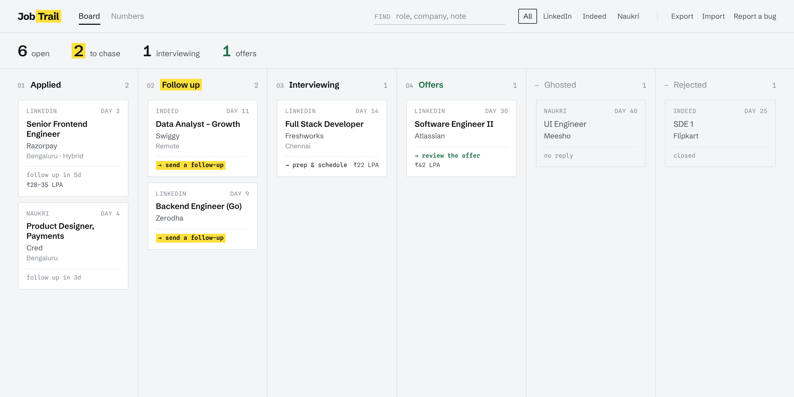
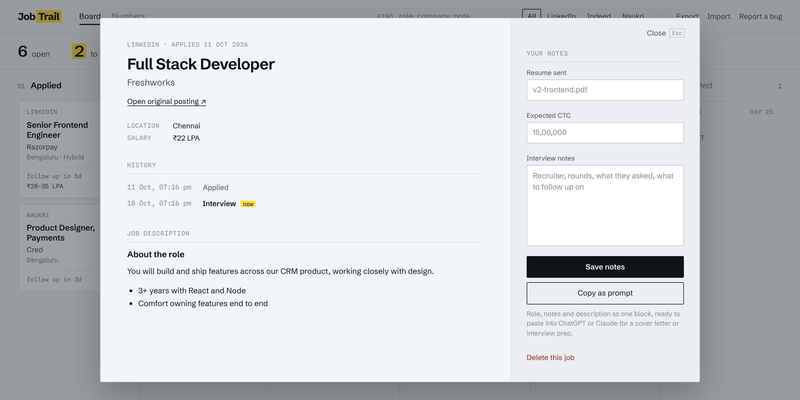
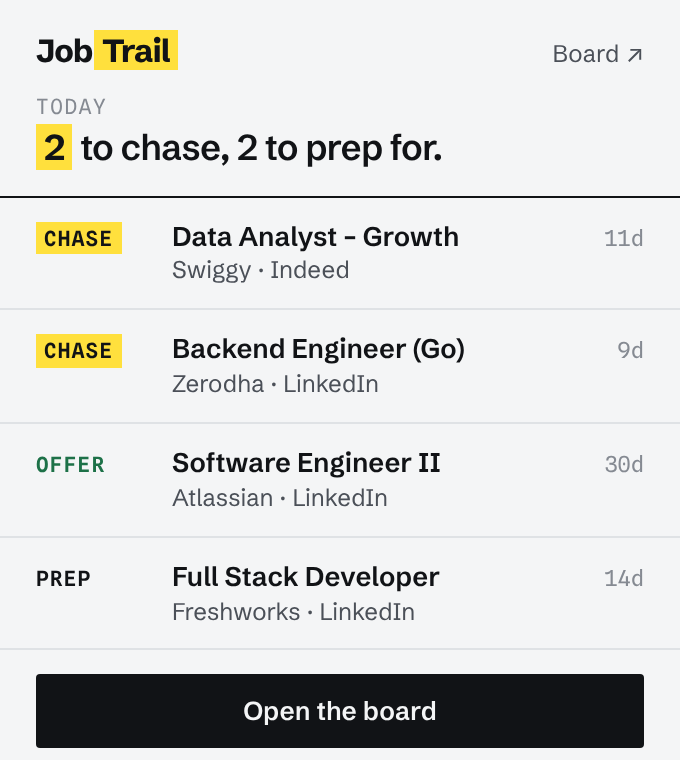
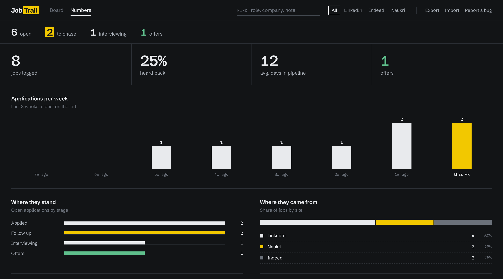

# JobTrail

A Chrome extension that keeps a log of the jobs you apply to on LinkedIn, Indeed and Naukri, and tells you when it's time to follow up. Everything stays in your browser.



## What it does

When you click **Apply** on a job page, JobTrail saves the role, company, location, salary, the full description and a link back to the posting. A small note in the corner of the page confirms it. If you've already saved the same job from another site, it tells you.

From there:

- **Board.** Jobs sit in six columns: Applied, Follow up, Interviewing, Offers, Ghosted and Rejected. Drag a card to change its status. Each card shows how many days ago you applied and what to do next.
- **Follow-up nudges.** A job that's been in Applied for 7 days moves to Follow up on its own. Twice a day JobTrail checks, and sends a desktop notification if anything needs you.
- **Popup.** Click the toolbar icon to see the few jobs to chase or prepare for today.
- **Job detail.** Keep notes, the resume version you sent and your expected CTC next to the saved description, with a dated history of status changes.
- **Copy as prompt.** Copies the role, your notes and the description as one block of text, to paste into ChatGPT or Claude when writing a cover letter or preparing for an interview.
- **Numbers.** Applications per week, where your open applications stand, which sites they came from, and the companies you apply to most.
- **Export and import.** Back up everything to a JSON file, or move it to another browser.

<p align="center">
  
  &nbsp;
  
</p>



<sub>Screenshots use sample data. The UI follows your system's light or dark setting.</sub>

## Your data

Jobs are stored in `chrome.storage.local` on your computer. There's no account, no server and no analytics, and the extension doesn't send your data anywhere. Even the fonts are bundled, so opening the board makes no network requests.

It asks for these permissions:

| Permission | Why |
| --- | --- |
| Access to linkedin.com, indeed.com, naukri.com | To notice the Apply click and read the job details from the page |
| `storage` | To save your jobs locally |
| `alarms`, `notifications` | For the twice-daily follow-up check |

## Install

JobTrail isn't on the Chrome Web Store yet, so you load it yourself:

1. Clone the repository, or download it as a ZIP and unzip it:
   ```bash
   git clone https://github.com/harshalpendse/JobTrail.git
   ```
2. Open `chrome://extensions` in Chrome.
3. Turn on **Developer mode** (top right).
4. Click **Load unpacked** and select the `JobTrail` folder.
5. Pin JobTrail from the extensions menu, then apply to a job as usual.

To update, pull the latest code and click the reload icon on JobTrail's card in `chrome://extensions`.

## How it's built

Plain HTML, CSS and JavaScript on Manifest V3, with no frameworks or chart libraries. Content scripts watch for Apply clicks on each site, a background service worker runs the follow-up check, and the board and popup read straight from local storage. [ARCHITECTURE.md](ARCHITECTURE.md) has the details.

## Contributing

Bug reports and pull requests are welcome on the [issues page](https://github.com/harshalpendse/JobTrail/issues). Job sites change their markup often, so if JobTrail stops catching applications on one of them, please open an issue with the job URL.

## License

MIT.
